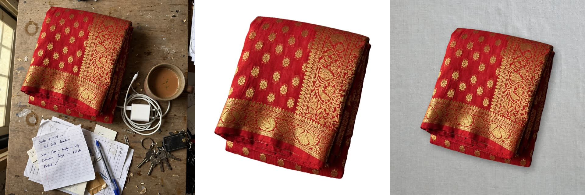
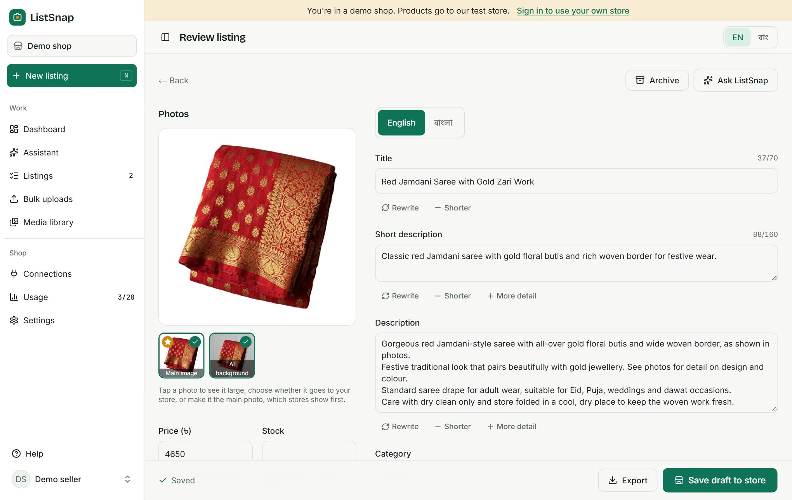
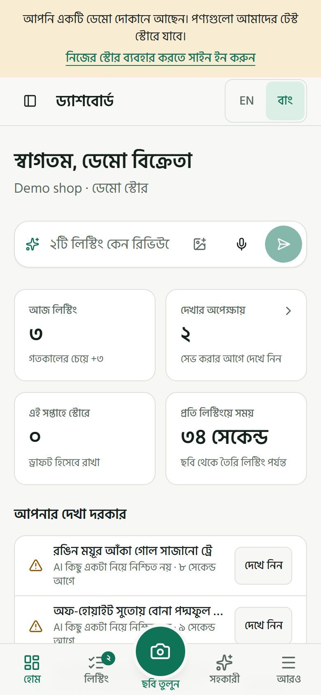
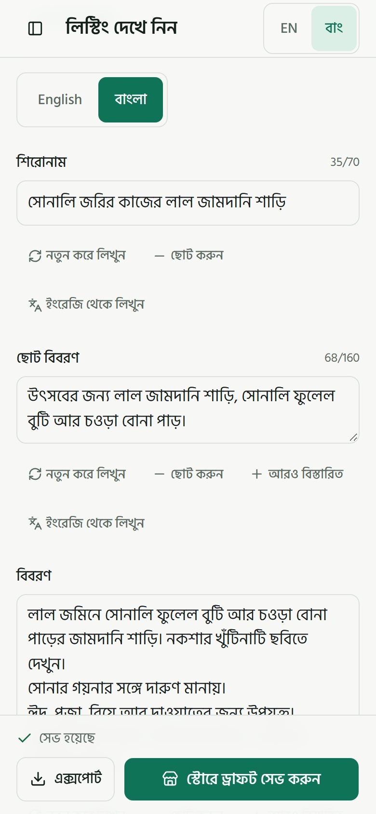

# ListSnap

**Snap a product photo. Get a store listing in English and Bangla.**

ListSnap is for small social-commerce sellers in Bangladesh. One phone photo, a voice note or a short video of the products becomes a Shopify or WooCommerce draft with a written listing, clean cutouts, studio photos and a reel for Facebook and Instagram, in English and Bangla. Built for the Meta Global AI Developer Hackathon (Indie track, "Build for Your World").

**Demo video:** [watch ListSnap on YouTube](https://youtu.be/QWnTnwDFm-o)



_From the demo shop's sample listings: the seller-style photo (itself made with Muse Image for the demo), the SAM 3.1 cutout and the studio photo._



<p>
  
  
</p>

## Try it

- **Hosted:** open [getlistsnap.com](https://getlistsnap.com) and choose **Try the demo shop** on the sign-in page. It needs no account or password. A demo shop starts with three sample listings, offers sample photos on Snap, saves drafts to our test store and ends after 24 hours. Each visitor has daily limits on listings and AI calls.
- **On your own machine:** follow [Run it locally](#run-it-locally). Every outside service is mocked by default, so it needs no keys and no accounts.

Demo shops can't connect a seller's own store or Facebook Page. To see those flows, run it locally, sign in with an email link and connect the mock services under Connections.

On any job, the **Details** panel lists each model call with its real model name, timing and cost, and marks calls that were mocked.

## What it does

- **Snap:** one photo becomes a listing. A voice note adds what the seller said (price, sizes, stock, fabric), which the listing uses over guesses from the photo.
- **Bulk and video uploads:** many photos at once, one listing each. Or film the rack while saying each price, the way sellers do on Facebook Live, and every product becomes its own listing.
- **Review:** checks first, every field editable, AI help buttons on the text, suggested prices, and a shop assistant chat for the listing.
- **Photos:** a clean cutout, studio and banner photos that keep the product's real pixels, labelled AI scenes, and campaign looks for an occasion, all in the shop's brand kit.
- **Save:** drafts in Shopify and WooCommerce (colour variants as variable products), never published ones; also the seller's Facebook catalog, a Facebook Marketplace helper and CSV exports.
- **Reels:** a 12-second video of a listing, posted to the seller's Facebook Page and Instagram after they approve the caption.
- **Assistant:** a shop-wide chat that takes photos and voice, and can start a listing. Spoken words appear in the message box while the seller talks, in Bangla, English or both, for them to check before sending.

## Meta models

Every model ListSnap calls at runtime is a Meta model.

| Model                 | Model ID                           | Where it runs                 | What it does in ListSnap                                                                                                                                                                                                                          |
| --------------------- | ---------------------------------- | ----------------------------- | ------------------------------------------------------------------------------------------------------------------------------------------------------------------------------------------------------------------------------------------------- |
| Muse Spark            | `muse-spark-1.3`                   | Meta Model API (dev.meta.ai)  | Plans each photo, groups items into products, sets or colour variants, writes the English listing and its natural Bangla version, the Review help buttons and the chat                                                                            |
| SAM 3.1               | `sam-3.1`                          | Meta Model API (dev.meta.ai)  | Finds every matching item from a short phrase, and its masks make the cutouts. ListSnap uses its boxes for the fill, cut-off and overlap hints. It also finds the product again in AI scenes, so ListSnap can compare the colours with the cutout |
| Muse Image            | `muse-image-1.0`                   | Meta Model API (dev.meta.ai)  | Studio, banner and lifestyle photos, and campaign looks, around the real cutout                                                                                                                                                                   |
| Muse Voice Transcribe | `muse-voice-transcribe-1.0`        | Meta Model API (dev.meta.ai)  | Writes down voice notes and a video's speech turn by turn with times; streams the words of a chat message live, over its realtime socket, while the seller is still talking                                                                       |
| Muse Spark Open       | `meta-models/muse-spark-open-1026` | Baseten (Meta's open weights) | Reads the price, sizes and stock out of what the seller said; watches a product video with its transcript and lists each product; hears the audio itself if Transcribe fails                                                                      |

Muse Spark Open is the open-weight model: voice notes and product videos go through it on Baseten, called from [`src/server/providers/baseten/`](src/server/providers/baseten/). The Meta Model API calls are in [`src/server/providers/meta/`](src/server/providers/meta/).

## How a listing is made

| Step      | Model                                  | What happens                                                                                                                  |
| --------- | -------------------------------------- | ----------------------------------------------------------------------------------------------------------------------------- |
| Listen    | Muse Voice Transcribe, Muse Spark Open | Optional: the voice note becomes words, then the facts the seller said                                                        |
| Plan      | Muse Spark                             | Picks what to cut out ("jamdani saree"), how many items there are, and the camera angle                                       |
| Segment   | SAM 3.1                                | Cuts each item out onto white and checks the photo                                                                            |
| Group     | Muse Spark                             | When there are several items: separate products, a set, or colour variants                                                    |
| Write     | Muse Spark                             | Title, descriptions, attributes, tags, category, a BDT price range and a confidence score                                     |
| Translate | Muse Spark                             | A natural Bangla version, not word-for-word                                                                                   |
| Render    | Muse Image                             | Studio and banner photos keep the product's real pixels on a generated background; the lifestyle scene is labelled "AI scene" |
| Save      | Shopify, WooCommerce                   | Creates or updates a **draft** product in each connected store                                                                |

Each step is one short request, with its state and lock in MySQL. By default the browser drives the steps, so a job waits while its tab is closed. With `PIPELINE_WORKER` set to `all`, or `batches` for video batches only, the server runs the automatic steps too, under the same locks, so the job carries on without the tab. A refresh, a second tab or a server restart repeats nothing that already finished.

## Run it locally

Requirements: Node 24, pnpm, Docker, and ffmpeg on the PATH for voice notes and videos.

```bash
pnpm install
cp .env.example .env.local          # then set BETTER_AUTH_SECRET and CREDENTIALS_KEY (openssl rand -base64 32)
pnpm db:up                          # MariaDB 11.4 in Docker on port 3307
pnpm db:migrate
pnpm dev                            # http://localhost:3000
```

Every outside service is mocked by default (`PROVIDER_MODE_*=mock`), so the whole flow works with no keys and no account. Use **Try the demo shop** on the sign-in page, where the sample listings and photos from [`public/samples/`](public/samples/) are ready to try, or an email link (in development the link is printed in the server console). Google sign-in appears once `GOOGLE_CLIENT_ID` and `GOOGLE_CLIENT_SECRET` are set.

In mock mode a photo at least twice as wide as it is tall is treated as three different products, which shows the Choose items step.

### Live models

Set these in `.env.local` and restart `pnpm dev`:

| Setting                                                                     | Turns on                                                      |
| --------------------------------------------------------------------------- | ------------------------------------------------------------- |
| `PROVIDER_MODE_META=live`, `MODEL_API_KEY`                                  | Muse Spark, SAM 3.1, Muse Image and Muse Voice Transcribe     |
| `PROVIDER_MODE_BASETEN=live`, `BASETEN_API_KEY`                             | Muse Spark Open                                               |
| `PROVIDER_MODE_VIDEO=live`                                                  | Real reel renders (HyperFrames downloads Chrome on first use) |
| `PROVIDER_MODE_SHOPIFY=live`, `SHOPIFY_CLIENT_*`                            | Connecting a Shopify store                                    |
| `PROVIDER_MODE_FACEBOOK=live`, `PROVIDER_MODE_INSTAGRAM=live`, `META_APP_*` | Facebook Login, the Facebook catalog and posting reels        |

`.env.example` explains each one.

### A local WooCommerce store

To save drafts to a real WooCommerce store without a hosted shop, start the local test store. It runs WordPress and WooCommerce in Docker on http://localhost:8080 and writes its REST keys into `.env.local` as the demo store:

```bash
pnpm store:setup
```

Then set `PROVIDER_MODE_WOO=live` in `.env.local`. Demo shops now save their drafts to the local store, which downloads product images from the app through short-lived signed links.

### Checks

```bash
pnpm typecheck && pnpm lint && pnpm test && pnpm build
pnpm eval:chat                      # the chat against live Muse Spark; needs MODEL_API_KEY
```

To run it on a server, follow [DEPLOY.md](DEPLOY.md). `GET /api/health` reports whether a deploy can reach its database and media folder.

## Stack

Next.js 16 (App Router) · React 19 · TypeScript · MariaDB/MySQL via `mysql2` · Better Auth (Google, magic link, demo) · shadcn/ui (Base UI) · Tailwind CSS v4 · next-intl (English and Bangla) · sharp · HyperFrames and GSAP for reels · Vitest.

## License

[MIT](LICENSE)
